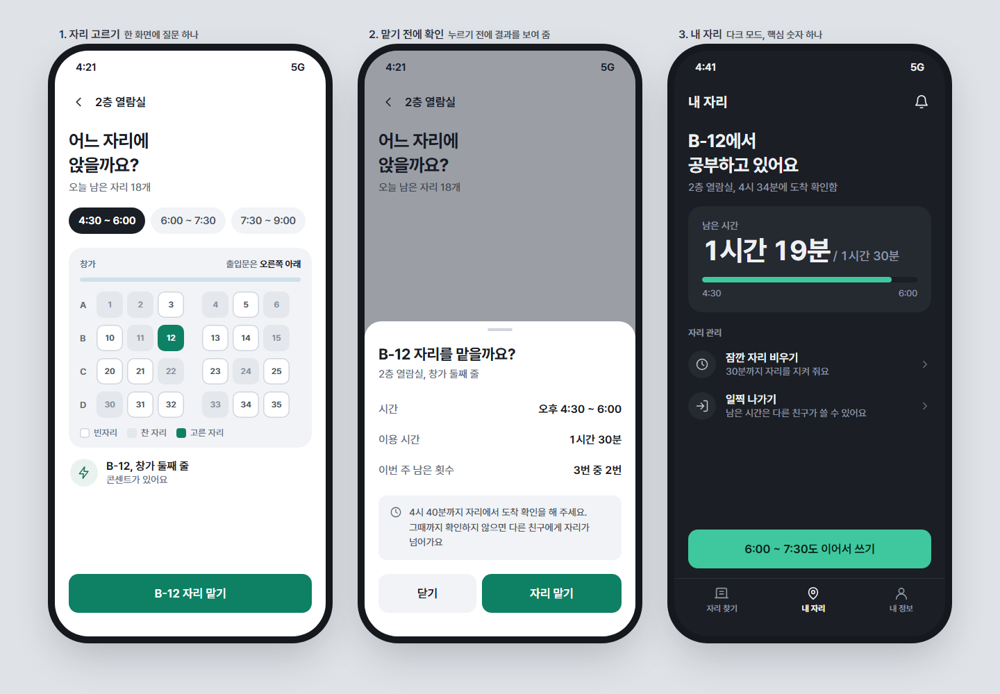
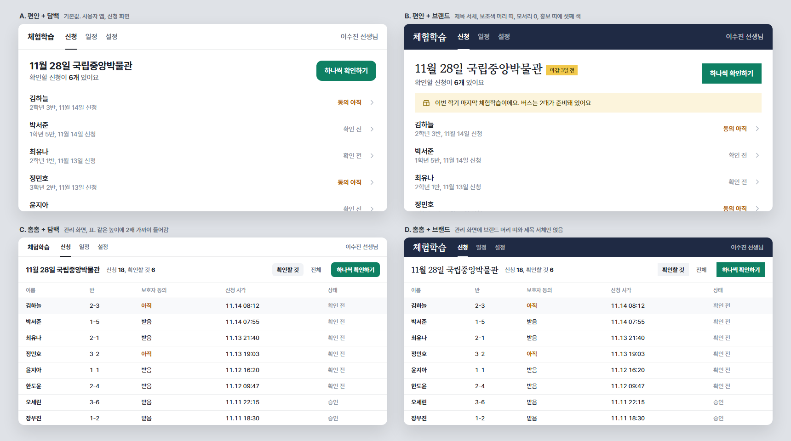
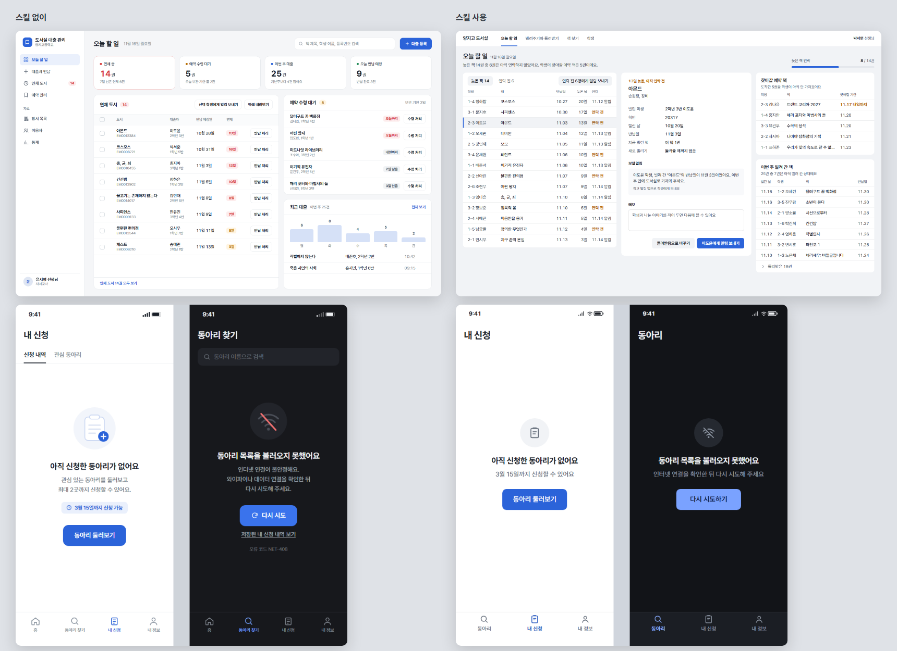

# 당토 디자인 (dangto-design)

Claude Code가 앱 화면이나 웹 도구를 만들 때 당근과 토스의 디자인 원칙을 따르게 하는 스킬입니다.

꾸밈을 더하기보다 덜어내는 쪽입니다. 화면마다 할 일 하나를 분명히 하고, 정보의 순서와 크기로 완성도를 냅니다. 설명서 없이도 바로 쓸 수 있는 화면을 목표로 합니다.



위 그림은 가상의 도서관 자리 신청 앱에 이 스킬을 적용한 예시입니다. 왼쪽부터 자리 고르기, 자리를 맡기 전 확인, 내 자리(다크 모드) 화면입니다.

## 주요 내용

스킬에는 당근(SEED Design)과 토스(TDS, 제품 원칙, UX 글쓰기)의 공개 자료에서 뽑은 규칙이 들어 있습니다. 화면 원칙 6개를 바탕으로 색, 글자, 간격, 모서리, 그림자, 움직임 값을 CSS 파일 하나로 정리했고, 다크 모드 값도 따로 정해 두었습니다.

강조색은 프리셋 6가지(숲, 바다, 제비꽃, 노을, 개나리, 먹) 중에서 고르거나 원하는 색 값을 넣으면 됩니다. 색 하나만 정하면 연한 색, 누를 때 색, 다크 모드 색이 함께 정해지고, 글자가 잘 보이는지(대비 4.5:1)도 확인합니다.

화면 밀도는 두 가지입니다. 학생이나 고객이 쓰는 화면은 글자와 여백이 넉넉한 "편안", 교사나 관리자가 쓰는 표와 관리 화면은 한눈에 많이 보이는 "촘촘"으로 만듭니다. 브랜드 느낌을 살리고 싶을 때는 제목 서체와 보조색을 더하는 "브랜드" 모드를 씁니다.

그 밖에 들어 있는 것은 다음과 같습니다.

- 목록, 버튼, 스위치, 대화상자, 빈 화면, 오류, 로딩, 입력 양식, 관리 화면을 만드는 방법
- 해요체와 쉬운 말로 화면 문구를 쓰는 규칙과 고쳐 쓰기 예시
- 버튼 같은 부품을 TDS, SEED에서 가져오는 방법과 라이선스 주의점
- Pretendard 서체 파일(인터넷 없이도 쓸 수 있음)과 제목용 서체 목록
- AI가 만든 화면에서 흔히 보이는 습관(같은 크기 숫자 카드 늘어놓기, 모든 줄에 색 태그 붙이기 등)을 피하는 목록
- 결과를 보여 주기 전에 스스로 확인하는 점검표





## 설치

Claude Code에서 아래 두 줄을 차례로 입력하면 됩니다.

```
/plugin marketplace add yhk1m/dangto-design
/plugin install dangto-design@dangto-design
```

새 버전은 `/plugin marketplace update dangto-design`을 입력한 뒤 `/plugin update dangto-design@dangto-design`으로 받습니다.

플러그인을 쓰지 않으려면 이 저장소의 `skills/dangto-design` 폴더를 통째로 복사해도 됩니다. 모든 프로젝트에서 쓰려면 `~/.claude/skills/`(Windows는 `C:\Users\<사용자이름>\.claude\skills\`)에, 한 프로젝트에서만 쓰려면 그 프로젝트의 `.claude/skills/`에 넣습니다.

## 사용법

화면을 만들어 달라고 하면 Claude가 이 스킬을 알아서 꺼내 쓰는 경우가 많습니다. 확실하게 쓰게 하려면 요청 앞에 `/dangto-design`을 붙이세요.

```
/dangto-design 도서실 대출 관리 화면 만들어 줘
```

색이나 모드를 정하고 싶으면 요청에 같이 적습니다. 적지 않으면 강조색은 숲, 밀도는 화면 종류에 맞게, 개성은 담백으로 정합니다.

```
/dangto-design 급식 알림 앱 설정 화면. 강조색은 노을, 다크 모드도 같이
/dangto-design 학원 관리자 화면. 강조색 #6847d6, 촘촘하게
/dangto-design 동아리 홍보 앱 첫 화면. 브랜드 모드, 보조색 #1f2a44
```

이미 만든 화면을 다듬을 때도 씁니다.

```
/dangto-design 이 화면 점검하고 고쳐 줘
```

앱 화면, 웹 도구, 관리자 화면, 설정, 입력 양식처럼 "쓰는" 화면에 맞춰 만든 스킬입니다. 랜딩 페이지, 포트폴리오, 발표 슬라이드처럼 "보여 주는" 화면에는 맞지 않습니다.

## 참고한 자료

당근과 토스의 공개 자료가 중심이고, 관리 화면과 브랜드 표현은 LINE, 원티드, 채널톡, 쏘카, 뱅크샐러드, 배민, 29CM, 카카오페이의 공개 자료를 참고했습니다. 규칙별 근거와 출처 주소는 [`references/sources.md`](skills/dangto-design/references/sources.md)에 있습니다.

이 스킬은 각 회사의 공식 자료가 아닙니다. 공개된 디자인 시스템 문서와 글을 읽고 개인이 정리했습니다. 회사 이름과 브랜드는 각 회사의 것이며, 프리셋 색은 회사 대표색을 그대로 쓰지 않았습니다.

## 파일 구성

```
skills/dangto-design/
  SKILL.md                   시작 절차, 원칙, 핵심 규칙, 금지 목록, 점검표
  references/tokens.md       색, 글자, 간격, 모서리, 그림자, 움직임 값
  references/accent.md       강조색 프리셋과 직접 넣은 색 확인 방법
  references/components.md   TDS, SEED 부품 가져오기
  references/fonts.md        서체 고르기와 불러오기
  references/patterns.md     화면 패턴
  references/writing.md      화면 문구 규칙과 고쳐 쓰기 예시
  references/sources.md      근거와 출처
  assets/tokens.css          바로 복사해 쓰는 CSS
  assets/fonts.css           Pretendard를 파일로 불러오는 CSS
  assets/fonts/              Pretendard 4종과 라이선스
  assets/examples/           적용 예시 그림과 코드
```

## 라이선스

스킬의 글과 코드는 [MIT 라이선스](LICENSE)입니다. 출처만 남기면 자유롭게 쓰고 고칠 수 있습니다.

서체는 각자의 라이선스를 따릅니다.

- Pretendard: Copyright (c) 2021 Kil Hyung-jin, SIL Open Font License 1.1. 파일과 라이선스 전문을 `assets/fonts/`에 함께 넣었습니다.
- 제목용 서체 6종: Google Fonts에서 불러오며 모두 SIL Open Font License입니다.
- 리틱체(REATIC): 리틱인더스트리의 서체로, 재배포가 금지되어 있어 이 저장소에는 넣지 않았습니다. 필요하면 [공식 페이지](https://www.reaticindustry.com/reaticfont)에서 직접 내려받으세요.

## 만든 사람

양정고등학교 지리교사 김용현  
문의: bgnlkim@gmail.com
