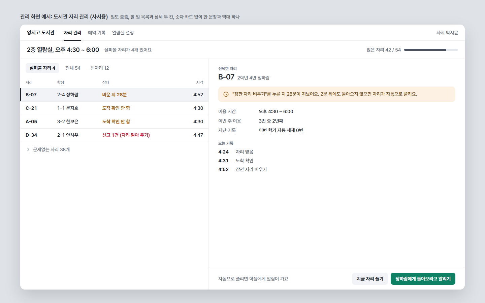

# 당토 디자인 (dangto-design)

Claude Code나 Codex가 앱 화면이나 웹 도구를 만들 때 당근과 토스의 디자인 원칙을 따르게 하는 스킬입니다. 두 도구에서 같은 스킬 파일을 그대로 씁니다.

꾸밈을 더하기보다 덜어내는 쪽입니다. 화면마다 할 일 하나를 분명히 하고, 정보의 순서와 크기로 완성도를 냅니다. 설명서 없이도 바로 쓸 수 있는 화면을 목표로 합니다.


위 그림은 가상의 도서관 자리 신청 앱에 이 스킬을 적용한 예시입니다. 왼쪽부터 자리 고르기, 자리를 맡기 전 확인, 내 자리(다크 모드) 화면입니다.

## 주요 내용

스킬에는 당근(SEED Design)과 토스(TDS, 제품 원칙, UX 글쓰기)의 공개 자료에서 뽑은 규칙이 들어 있습니다. 화면 원칙 6개를 바탕으로 색, 글자, 간격, 모서리, 그림자, 움직임 값을 CSS 파일 하나로 정리했고, 다크 모드 값도 따로 정해 두었습니다.

강조색은 프리셋 6가지(숲, 바다, 제비꽃, 노을, 개나리, 먹) 중에서 고르거나 원하는 색 값을 넣으면 됩니다. 색 하나만 정하면 연한 색, 누를 때 색, 다크 모드 색이 함께 정해지고, 글자가 잘 보이는지(대비 4.5:1)도 확인합니다.

화면 밀도는 두 가지입니다. 학생이나 고객이 쓰는 화면은 글자와 여백이 넉넉한 "편안", 교사나 관리자가 쓰는 표와 관리 화면은 한눈에 많이 보이는 "촘촘"으로 만듭니다. 브랜드 느낌을 살리고 싶을 때는 제목 서체와 보조색을 더하는 "브랜드" 모드를 씁니다.

그 밖에 들어 있는 것은 다음과 같습니다.

- 목록, 버튼, 스위치, 대화상자, 빈 화면, 오류, 로딩, 입력 양식, 관리 화면을 만드는 방법
- 스크롤바, 선택 상자의 펼친 목록, 체크와 라디오, 날짜 칸처럼 브라우저가 그리는 부품까지 다크 모드와 강조색을 따르게 하는 CSS
- 해요체와 쉬운 말로 화면 문구를 쓰는 규칙과 고쳐 쓰기 예시
- 버튼 같은 부품을 TDS, SEED에서 가져오는 방법과 라이선스 주의점
- Pretendard 서체 파일(인터넷 없이도 쓸 수 있음)과 제목용 서체 목록
- AI가 만든 화면에서 흔히 보이는 습관(같은 크기 숫자 카드 늘어놓기, 모든 줄에 색 태그 붙이기 등)을 피하는 목록
- 결과를 보여 주기 전에 스스로 확인하는 점검표와, 글자 대비나 작은 글자 같은 문제를 자동으로 찾는 점검 스크립트



관리 화면 예시입니다. 숫자 카드를 늘어놓는 대신 "살펴볼 자리가 4개 있어요"라는 한 문장과 막대 하나로 요약하고, 할 일 목록과 상세를 두 칸에 나눕니다.


## 설치

### Claude Code

아래 두 줄을 차례로 입력합니다.

```
/plugin marketplace add yhk1m/dangto-design
/plugin install dangto-design@dangto-design
```

새 버전은 `/plugin marketplace update dangto-design`을 입력한 뒤 `/plugin update dangto-design@dangto-design`으로 받습니다.

### Codex

터미널에서 아래 두 줄을 차례로 입력합니다.

```
codex plugin marketplace add yhk1m/dangto-design
codex plugin add dangto-design@dangto-design
```

새 버전은 `codex plugin marketplace upgrade dangto-design`으로 받습니다.

### 폴더를 직접 복사하기

플러그인을 쓰지 않으려면 이 저장소의 `skills/dangto-design` 폴더를 통째로 복사해도 됩니다.

| 도구 | 모든 프로젝트에서 쓰기 | 한 프로젝트에서만 쓰기 |
|---|---|---|
| Claude Code | `~/.claude/skills/dangto-design` | `프로젝트/.claude/skills/dangto-design` |
| Codex | `~/.agents/skills/dangto-design` | `프로젝트/.agents/skills/dangto-design` |

Windows에서 `~`는 `C:\Users\<사용자이름>`입니다.

## 사용법

화면을 만들어 달라고 하면 Claude Code나 Codex가 이 스킬을 알아서 꺼내 쓰는 경우가 많습니다. 확실하게 쓰게 하려면 요청 앞에 스킬 이름을 붙이세요. Claude Code는 `/dangto-design`, Codex는 `$dangto-design`입니다.

```
/dangto-design 도서실 대출 관리 화면 만들어 줘   (Claude Code)
$dangto-design 도서실 대출 관리 화면 만들어 줘   (Codex)
```

아래 예시는 Claude Code 기준입니다. Codex에서는 `/`를 `$`로 바꿔 쓰면 됩니다.

색이나 모드를 정하고 싶으면 요청에 같이 적습니다. 적지 않으면 강조색은 숲, 밀도는 화면 종류에 맞게, 개성은 담백으로 정합니다.

```
/dangto-design 급식 알림 앱 설정 화면. 강조색은 노을, 다크 모드도 같이
/dangto-design 학원 관리자 화면. 강조색 #6847d6, 촘촘하게
/dangto-design 동아리 홍보 앱 첫 화면. 브랜드 모드, 보조색 #1f2a44
```

이미 만든 화면을 다듬을 때도 씁니다.

```
/dangto-design 이 화면 점검하고 고쳐 줘
```

앱 화면, 웹 도구, 관리자 화면, 설정, 입력 양식처럼 "쓰는" 화면에 맞춰 만든 스킬입니다. 랜딩 페이지, 포트폴리오, 발표 슬라이드처럼 "보여 주는" 화면에는 맞지 않습니다.

## 화면 점검 스크립트

만든 HTML 화면을 라이트와 다크, 휴대폰 폭과 데스크톱 폭에서 열어 문제를 찾아 줍니다. 스킬을 쓰면 Claude Code와 Codex 모두 화면을 만든 뒤 알아서 돌리고, 직접 돌릴 수도 있습니다. Node 18 이상과 Chrome이 필요합니다.

```
node skills/dangto-design/scripts/check.mjs 내화면.html
```

찾는 것은 글자 대비 4.5:1 미만, 12px보다 작은 글자, 순수 검정, 이모지, 가운데 점과 긴 대시, 44px보다 작은 터치 영역, 채운 강조색 버튼 여러 개, 휴대폰 폭에서 가로로 넘치는 화면, 다크 모드에서 하얗게 남는 스크롤바와 선택 상자입니다. 문제가 있으면 끝 코드 1로 끝나서 자동화에도 쓸 수 있습니다.

## 스킬 평가

`evals/`에 관리 화면, 휴대폰 신청 화면, 빈 화면과 오류 화면을 만드는 시험 문제 3개가 들어 있습니다. 같은 문제를 스킬을 켠 쪽과 끈 쪽으로 나눠 풀게 하고 점수를 비교합니다. 스킬을 고친 뒤 결과가 나빠지지 않았는지 확인할 때 씁니다.

```
claude plugin eval . --allow-tools Write
```

문제마다 기본 3번씩 두 쪽을 돌리므로 사용량이 꽤 듭니다. 처음에는 `--case mobile-form --runs 1`처럼 하나만 돌려 보세요. 2026년 11월에 세 문제를 3번씩 돌린 결과는 아래와 같습니다(만점 1.00).

| 문제 | 스킬 켬 | 스킬 끔 |
|---|---|---|
| 관리 화면 | 1.00 | 0.37 |
| 빈 화면과 오류 | 0.78 | 0.41 |
| 휴대폰 신청 화면 | 1.00 | 0.59 |
| 평균 | 0.93 | 0.46 |

화면 구성은 AI 판정관 3명이 다수결로 채점해서 같은 결과물에도 판정이 갈릴 때가 있습니다. 빈 화면과 오류 문제는 앞선 평가에서 3번 모두 1.00이었고, 이번에는 판정이 2 대 1로 갈린 회차가 2번 있었습니다.

스킬을 끈 쪽은 다크 모드를 빠뜨리거나, 가운데 점과 이모지를 쓰거나, 관리 화면에 숫자 카드를 늘어놓는 경우가 많았습니다.

평가 도구는 Claude Code의 `claude plugin eval` 기능이라 Claude Code에서만 돌릴 수 있습니다. 스킬 자체는 Codex에서도 똑같이 작동합니다.

## 참고한 자료

당근과 토스의 공개 자료가 중심이고, 관리 화면과 브랜드 표현은 LINE, 원티드, 채널톡, 쏘카, 뱅크샐러드, 배민, 29CM, 카카오페이의 공개 자료를 참고했습니다. 규칙별 근거와 출처 주소는 [`references/sources.md`](skills/dangto-design/references/sources.md)에 있습니다.

이 스킬은 각 회사의 공식 자료가 아닙니다. 공개된 디자인 시스템 문서와 글을 읽고 개인이 정리했습니다. 회사 이름과 브랜드는 각 회사의 것이며, 프리셋 색은 회사 대표색을 그대로 쓰지 않았습니다.

## 파일 구성

```
.claude-plugin/              Claude Code 플러그인 정보
.codex-plugin/               Codex 플러그인 정보
.agents/plugins/             Codex 마켓플레이스 정보
skills/dangto-design/
  SKILL.md                   시작 절차, 원칙, 핵심 규칙, 금지 목록, 점검표
  references/tokens.md       색, 글자, 간격, 모서리, 그림자, 움직임 값
  references/accent.md       강조색 프리셋과 직접 넣은 색 확인 방법
  references/components.md   TDS, SEED 부품 가져오기
  references/fonts.md        서체 고르기와 불러오기
  references/patterns.md     화면 패턴
  references/writing.md      화면 문구 규칙과 고쳐 쓰기 예시
  references/sources.md      근거와 출처
  assets/tokens.css          바로 복사해 쓰는 CSS
  assets/fonts.css           Pretendard를 파일로 불러오는 CSS
  assets/fonts/              Pretendard 4종과 라이선스
  assets/examples/           적용 예시 그림과 코드 (휴대폰, 관리 화면)
  scripts/check.mjs          화면 자동 점검 스크립트
evals/                       스킬 평가 문제 3개
```

## 라이선스

스킬의 글과 코드는 [MIT 라이선스](LICENSE)입니다. 출처만 남기면 자유롭게 쓰고 고칠 수 있습니다.

서체는 각자의 라이선스를 따릅니다.

- Pretendard: Copyright (c) 2021 Kil Hyung-jin, SIL Open Font License 1.1. 파일과 라이선스 전문을 `assets/fonts/`에 함께 넣었습니다.
- 제목용 서체 6종: Google Fonts에서 불러오며 모두 SIL Open Font License입니다.

## 만든 사람

양정고등학교 지리교사 김용현  
문의: bgnlkim@gmail.com
